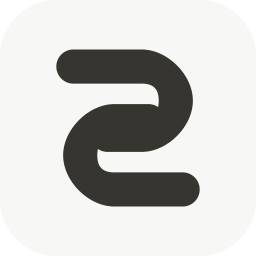
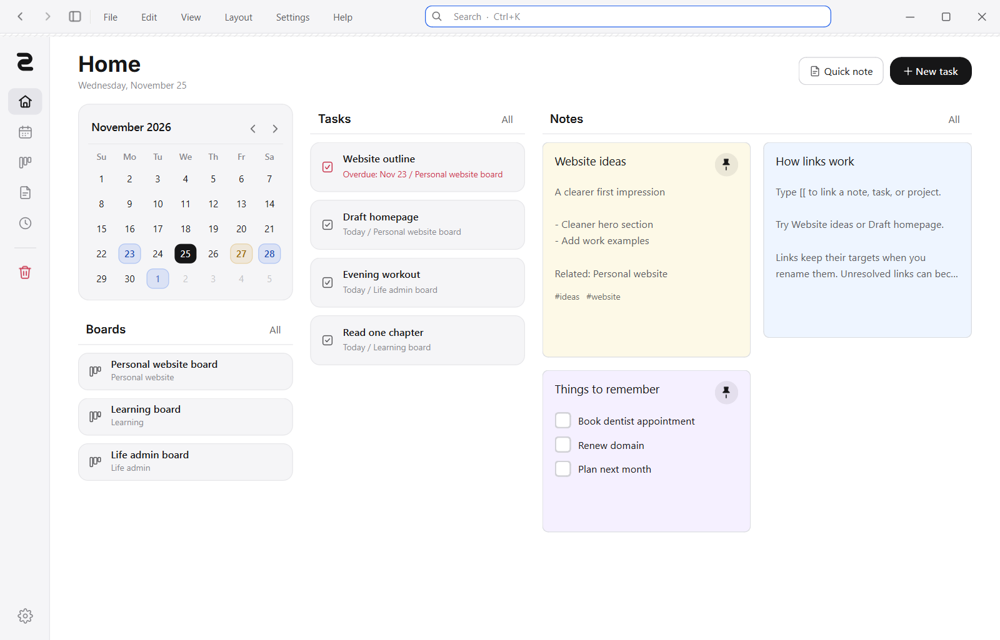
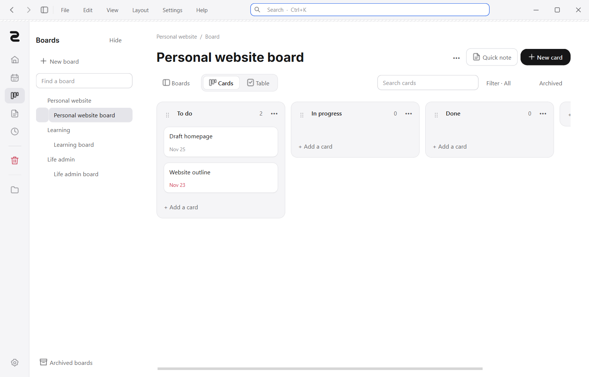
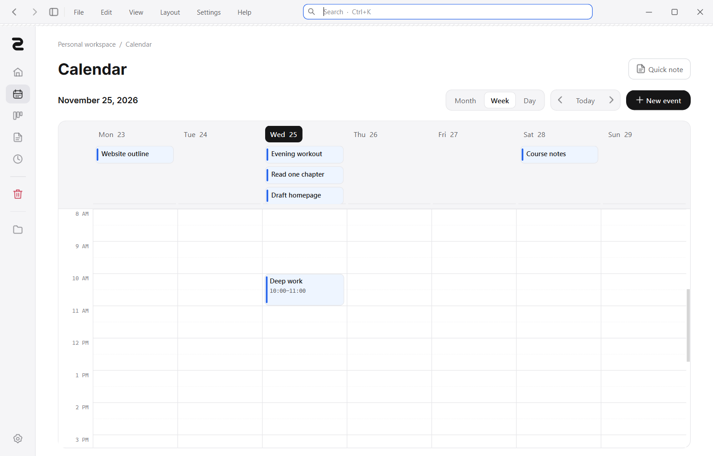
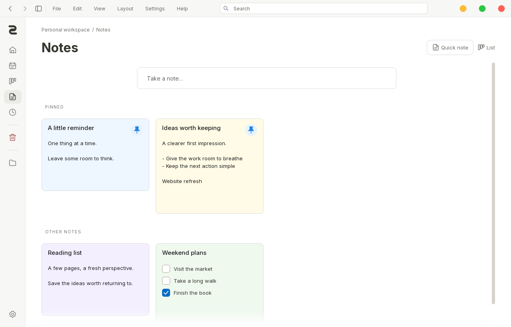
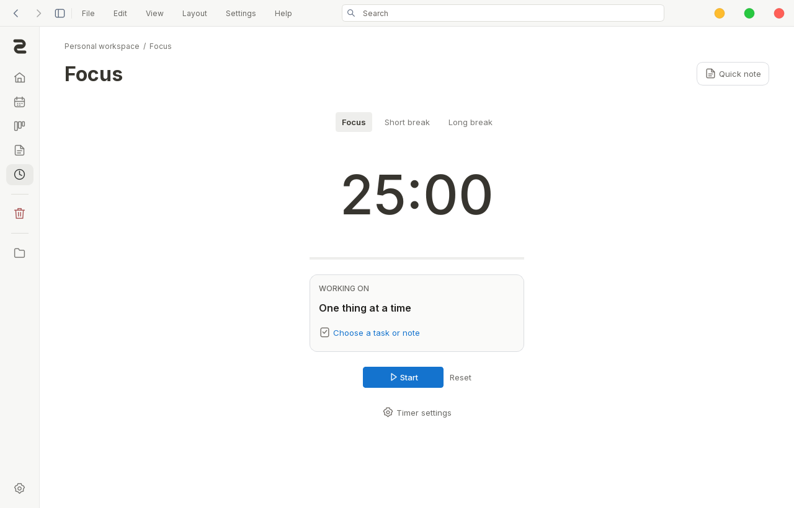

<p align="center"></p>
<h1 align="center">TABLA</h1>
<p align="center">
  
  
  
</p>
<p align="center">A little order. A lot more room.</p>
<p align="center">A local personal workspace for Windows · Version 0.9.0</p>



TABLA brings your tasks, calendar, notes and focus sessions into one native Windows app. Your workspace stays on your computer. No account or internet connection is required.

[Download for Windows](https://github.com/Changelo06/Tabla/releases/latest) · [Quick guide](docs/USER_GUIDE.md) · [MIT license](LICENSE)

## What you can do

- **Start at Home:** see upcoming tasks, your calendar, board shortcuts and recent notes.
- **Move work forward:** organize projects into independent boards with lists, cards, checklists, labels and attachments.
- **Plan your time:** use month, week and day calendars for events, deadlines and work blocks.
- **Keep your ideas:** capture formatted notes with colors, pins, checklists, images, tables and links.
- **Make space to focus:** choose a task or note and use a configurable Pomodoro timer with breaks and local session history.
- **Find and protect your work:** search locally, restore deleted items and export portable JSON backups.

<table><tr><td></td><td></td></tr><tr><td></td><td></td></tr></table>

All screenshots use a separate sample workspace.

## Run the Windows app

1. Download `Tabla-Windows-0.9.0.zip` from [Releases](https://github.com/Changelo06/Tabla/releases). Choose the Windows package, rather than the automatic source-code archive.
2. Right-click the ZIP and choose **Extract All**.
3. Move the complete `Tabla` folder to a convenient location, such as `C:\Users\YourName\Apps\Tabla`.
4. Open **Tabla.exe**. Python is not required.

Keep `_internal`, licenses and notices beside the executable. TABLA is portable; there is no installation wizard. You can create a desktop shortcut to `Tabla.exe`. Moving this app folder does not move your saved workspace.

The current package targets Windows x64 and is unsigned. It has no automatic updater. To update, extract the new app into a separate folder and launch it; your workspace is stored separately from the app.

## Run from source

Use Windows x64 and Python 3.11. In PowerShell, from the repository folder:

```powershell
py -3.11 -m venv .venv
.\.venv\Scripts\python.exe -m pip install -r requirements.txt
.\.venv\Scripts\python.exe run_tabla.py
```

The first workspace starts empty. To explore sample content in a separate local workspace:

```powershell
.\.venv\Scripts\python.exe run_tabla.py --data-dir build/demo --demo
```

## Your data

The default workspace lives under `%LOCALAPPDATA%\Tabla`. Settings shows the exact folder and provides JSON import/export. Database snapshots alone do not include attachment files; export a JSON backup to keep referenced attachments with your records. This version does not encrypt the database.

See the [user guide](docs/USER_GUIDE.md) for notes, shortcuts, backups and timer behavior, and the [data format](DATA-FORMAT.md) for the portable export contract.

## Development and packaging

```powershell
.\.venv\Scripts\python.exe -m pip install -r requirements-dev.txt
.\.venv\Scripts\python.exe scripts/run_tests.py
.\.venv\Scripts\python.exe scripts/package_release.py
```

The release command builds the Windows app, checks the packaged executable using disposable data, and creates a versioned portable ZIP and SHA-256 checksum in `release/`. See [CONTRIBUTING.md](CONTRIBUTING.md) and the [release guide](docs/RELEASING.md).

## Current scope

TABLA is a single-user, offline Windows app. Cloud sync, collaboration, recurring tasks, Google Calendar integration and mobile apps are not included. Calendar times are local and same-day; split events that cross midnight.

## License and credits

TABLA's original source code is available under the [MIT License](LICENSE). Third-party components retain their own licenses; see [THIRD_PARTY_NOTICES.md](THIRD_PARTY_NOTICES.md). TABLA uses Python, Qt for Python, SQLite and bundled Inter fonts.
